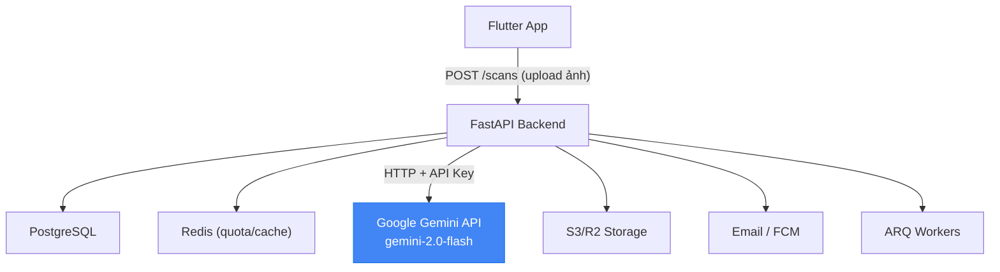
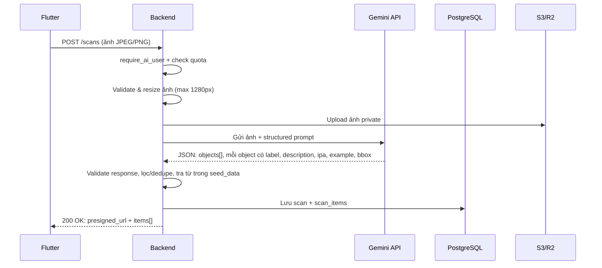

# 🔄 Kế Hoạch Tích Hợp Google Gemini API Thay Thế YOLO-World

## 1. Tổng Quan Thay Đổi

| Trước (YOLO-World) | Sau (Gemini API) |
|---|---|
| Tự host container YOLO-World | Gọi Google Gemini API qua internet |
| Cần GPU server, Docker container riêng | Chỉ cần API key + HTTP client |
| Chỉ trả `label + confidence + bounding_box` | Trả `label + mô tả + IPA + ví dụ câu + bounding_box (ước lượng)` |
| Chi phí infra cao | Miễn phí (free tier 15 RPM / 1M tokens/tháng) hoặc rất rẻ |
| Offline/nội bộ | Cần internet |

> [!IMPORTANT]
> Thay đổi này **chỉ ảnh hưởng backend** (`integrations/detector/` → `integrations/gemini/`). Flutter FE và scan module API contract **không thay đổi** — FE vẫn gửi ảnh, nhận lại danh sách vật thể.

## 2. Kiến Trúc Mới



### So sánh flow scan:



## 3. Cấu Trúc File Thay Đổi

### 3.1 Xóa bỏ
```diff
- backend/app/integrations/detector/          # Toàn bộ thư mục YOLO-World client
-   ├── client.py
-   ├── schemas.py
-   └── errors.py
```

### 3.2 Tạo mới
```
backend/app/integrations/gemini/
├── __init__.py
├── client.py          # Gemini API client (gọi generateContent)
├── schemas.py         # Pydantic models cho request/response
├── prompts.py         # Structured prompt cho object detection
└── errors.py          # Map lỗi Gemini → lỗi adapter
```

### 3.3 Cập nhật
```diff
  backend/app/core/config.py
+   GEMINI_API_KEY: str            # từ environment variable
+   GEMINI_MODEL: str = "gemini-2.0-flash"
+   GEMINI_TIMEOUT: int = 30       # seconds
-   DETECTOR_URL: str              # URL container YOLO-World
-   DETECTOR_TIMEOUT: int = 30

  backend/app/modules/scan/service.py
    # Thay đổi: gọi gemini_client thay vì detector_client
    # Logic lọc/dedupe/limit giữ nguyên

  docker-compose.yml (khi tạo)
    # Bỏ container yolo-world
```

## 4. Chi Tiết Từng File Mới

### 4.1 `integrations/gemini/client.py`

```python
"""
Google Gemini API client cho object detection từ ảnh.
Thay thế YOLO-World detector container.
"""
import httpx
import base64
from typing import Optional

from app.core.config import settings
from .schemas import GeminiDetectionResponse, DetectedObject
from .prompts import OBJECT_DETECTION_PROMPT
from .errors import (
    GeminiUnavailableError,
    GeminiTimeoutError,
    GeminiInvalidResponseError,
    GeminiQuotaExceededError,
)


class GeminiClient:
    """HTTP client gọi Gemini API để nhận diện vật thể trong ảnh."""

    BASE_URL = "https://generativelanguage.googleapis.com/v1beta"

    def __init__(self):
        self._api_key = settings.GEMINI_API_KEY
        self._model = settings.GEMINI_MODEL
        self._timeout = settings.GEMINI_TIMEOUT

    async def detect_objects(
        self,
        image_bytes: bytes,
        mime_type: str = "image/jpeg",
        max_objects: int = 8,
    ) -> list[DetectedObject]:
        """
        Gửi ảnh tới Gemini API, yêu cầu nhận diện vật thể
        và trả về danh sách DetectedObject.

        - Không log ảnh/base64
        - Timeout 30s
        - Không retry tự động (tránh tốn quota)
        """
        url = (
            f"{self.BASE_URL}/models/{self._model}:generateContent"
            f"?key={self._api_key}"
        )

        # Encode ảnh base64 để gửi inline
        image_b64 = base64.b64encode(image_bytes).decode("utf-8")

        payload = {
            "contents": [
                {
                    "parts": [
                        {
                            "inlineData": {
                                "mimeType": mime_type,
                                "data": image_b64,
                            }
                        },
                        {
                            "text": OBJECT_DETECTION_PROMPT.format(
                                max_objects=max_objects
                            )
                        },
                    ]
                }
            ],
            "generationConfig": {
                "responseMimeType": "application/json",
                "temperature": 0.1,  # Deterministic hơn cho detection
            },
        }

        async with httpx.AsyncClient(timeout=self._timeout) as client:
            try:
                response = await client.post(url, json=payload)
            except httpx.TimeoutException:
                raise GeminiTimeoutError()
            except httpx.ConnectError:
                raise GeminiUnavailableError()

        if response.status_code == 429:
            raise GeminiQuotaExceededError()
        if response.status_code != 200:
            raise GeminiUnavailableError(
                f"Gemini API returned {response.status_code}"
            )

        return self._parse_response(response.json())

    def _parse_response(self, data: dict) -> list[DetectedObject]:
        """Parse và validate response từ Gemini."""
        try:
            # Gemini trả text JSON trong candidates[0].content.parts[0].text
            text = data["candidates"][0]["content"]["parts"][0]["text"]
            parsed = GeminiDetectionResponse.model_validate_json(text)
            return parsed.objects
        except (KeyError, IndexError, ValueError) as e:
            raise GeminiInvalidResponseError(str(e))
```

### 4.2 `integrations/gemini/prompts.py`

```python
"""
Structured prompts cho Gemini API.
Prompt yêu cầu trả JSON chuẩn để parse dễ dàng.
"""

OBJECT_DETECTION_PROMPT = """
You are an object detection assistant for an English learning app.

Analyze the image and identify real-world objects visible in the photo.
Return a JSON object with this EXACT structure:

{{
  "objects": [
    {{
      "label": "apple",
      "label_vi": "quả táo",
      "confidence": 0.95,
      "description": "A round red fruit",
      "ipa": "/ˈæp.əl/",
      "example_sentence": "I eat an apple every morning.",
      "bounding_box": {{
        "x_min": 0.1,
        "y_min": 0.2,
        "x_max": 0.5,
        "y_max": 0.7
      }}
    }}
  ]
}}

Rules:
- Return at most {max_objects} objects.
- "label" must be a single common English noun (lowercase).
- "label_vi" is the Vietnamese translation.
- "confidence" is your estimated confidence from 0.0 to 1.0.
- "ipa" is the IPA pronunciation of the label.
- "example_sentence" is a simple English sentence using the word.
- "bounding_box" coordinates are normalized 0.0 to 1.0 (relative to image dimensions).
- Only include clearly visible, identifiable objects.
- If no objects are found, return {{"objects": []}}.
- Do NOT include abstract concepts, text, or logos.
- Return ONLY the JSON, no extra text.
"""
```

### 4.3 `integrations/gemini/schemas.py`

```python
"""Pydantic models cho Gemini detection response."""
from pydantic import BaseModel, Field, field_validator


class BoundingBox(BaseModel):
    """Bounding box chuẩn hóa 0..1"""
    x_min: float = Field(ge=0.0, le=1.0)
    y_min: float = Field(ge=0.0, le=1.0)
    x_max: float = Field(ge=0.0, le=1.0)
    y_max: float = Field(ge=0.0, le=1.0)

    @field_validator("x_max")
    @classmethod
    def x_max_gt_x_min(cls, v, info):
        if "x_min" in info.data and v <= info.data["x_min"]:
            raise ValueError("x_max must be greater than x_min")
        return v

    @field_validator("y_max")
    @classmethod
    def y_max_gt_y_min(cls, v, info):
        if "y_min" in info.data and v <= info.data["y_min"]:
            raise ValueError("y_max must be greater than y_min")
        return v


class DetectedObject(BaseModel):
    """Một vật thể được nhận diện."""
    label: str = Field(min_length=1, max_length=50)
    label_vi: str = Field(default="", max_length=100)
    confidence: float = Field(ge=0.0, le=1.0)
    description: str = Field(default="", max_length=200)
    ipa: str = Field(default="", max_length=50)
    example_sentence: str = Field(default="", max_length=300)
    bounding_box: BoundingBox

    @field_validator("label")
    @classmethod
    def normalize_label(cls, v: str) -> str:
        return v.strip().lower()


class GeminiDetectionResponse(BaseModel):
    """Response tổng hợp từ Gemini."""
    objects: list[DetectedObject] = Field(default_factory=list, max_length=10)
```

### 4.4 `integrations/gemini/errors.py`

```python
"""Lỗi adapter cho Gemini API."""


class GeminiError(Exception):
    """Base error cho Gemini integration."""
    pass


class GeminiTimeoutError(GeminiError):
    """Gemini API không phản hồi trong thời gian cho phép."""
    def __init__(self, msg: str = "Gemini API timeout"):
        super().__init__(msg)


class GeminiUnavailableError(GeminiError):
    """Gemini API không khả dụng."""
    def __init__(self, msg: str = "Gemini API unavailable"):
        super().__init__(msg)


class GeminiInvalidResponseError(GeminiError):
    """Response từ Gemini không parse được."""
    def __init__(self, msg: str = "Invalid Gemini response"):
        super().__init__(msg)


class GeminiQuotaExceededError(GeminiError):
    """Hết quota Gemini API (rate limit)."""
    def __init__(self, msg: str = "Gemini API quota exceeded"):
        super().__init__(msg)
```

## 5. Thay Đổi Trong Scan Module

Scan service (`modules/scan/service.py`) chỉ cần thay injection:

```diff
  # Trước
- from app.integrations.detector.client import DetectorClient
- async def scan_image(self, image_bytes, ...):
-     result = await self.detector_client.detect(image_bytes)
-     objects = [obj for obj in result if obj.confidence >= 0.5]

  # Sau
+ from app.integrations.gemini.client import GeminiClient
+ from app.integrations.gemini.errors import (
+     GeminiTimeoutError, GeminiUnavailableError, GeminiQuotaExceededError
+ )
+ async def scan_image(self, image_bytes, ...):
+     try:
+         objects = await self.gemini_client.detect_objects(image_bytes)
+     except GeminiTimeoutError:
+         raise ScanFailedError("SCAN_FAILED")
+     except GeminiUnavailableError:
+         raise ScanFailedError("AI_TEMPORARILY_UNAVAILABLE")
+     except GeminiQuotaExceededError:
+         raise ScanFailedError("AI_TEMPORARILY_UNAVAILABLE")
+     # Lọc confidence >= 0.5, dedupe, limit 8 items — giữ nguyên
+     filtered = [o for o in objects if o.confidence >= 0.5][:8]
```

> [!NOTE]
> API contract với Flutter **không thay đổi**. FE vẫn gọi `POST /scans`, nhận lại cùng response format.

## 6. Config & Environment

### `.env` (local dev)
```env
# Gemini API
GEMINI_API_KEY=AIza...your-key-here
GEMINI_MODEL=gemini-2.0-flash
GEMINI_TIMEOUT=30
```

### Lấy API Key miễn phí
1. Vào [Google AI Studio](https://aistudio.google.com/apikey)
2. Đăng nhập Google Account
3. Click **"Create API Key"**
4. Copy key → đặt vào `.env`

### Free Tier Limits (2024+)
| Resource | Giới hạn |
|---|---|
| Requests per minute | 15 RPM |
| Tokens per minute | 1M TPM |
| Requests per day | 1,500 RPD |
| Giá khi vượt free tier | ~$0.075 / 1M tokens |

> [!TIP]
> Với quota scan 10 lượt/user/ngày và free tier 1,500 request/ngày, đủ phục vụ **~150 users hoạt động/ngày** mà không tốn tiền.

## 7. Lợi Ích So Với YOLO-World

| Tiêu chí | YOLO-World (cũ) | Gemini API (mới) |
|---|---|---|
| **Chi phí server** | GPU server / container | $0 (free tier) |
| **Setup** | Docker + model weights + GPU drivers | 1 API key |
| **Kết quả** | Chỉ label + bbox | Label + nghĩa Việt + IPA + ví dụ câu + bbox |
| **Độ chính xác** | Tốt cho common objects | Rất tốt, hiểu ngữ cảnh |
| **Bounding box** | Pixel-perfect | Ước lượng (đủ dùng cho UI) |
| **Tốc độ** | ~2-5s (tùy GPU) | ~2-4s |
| **Scale** | Cần thêm container | Tự động (trả thêm tiền) |
| **Maintenance** | Update model, monitor GPU | Không cần |

## 8. Rủi Ro & Giải Pháp

| Rủi ro | Giải pháp |
|---|---|
| Bounding box không chính xác pixel-level | Chấp nhận — UX vẫn OK khi highlight vùng vật thể; prompt yêu cầu normalize 0..1 |
| Gemini trả response format sai | Validate bằng Pydantic, fallback trả "no objects found" |
| Rate limit 15 RPM | Redis rate limit phía backend + queue nếu cần |
| API key bị lộ | Chỉ lưu server-side `.env`, không commit, không gửi cho FE |
| Gemini API down | Trả 503 `AI_TEMPORARILY_UNAVAILABLE`, FE hiển thị thông báo thử lại |

## 9. Docker Compose Cập Nhật

```diff
  # Trước
  services:
    backend:
      ...
    postgres:
      ...
    redis:
      ...
-   yolo-world:
-     image: yolo-world:latest
-     deploy:
-       resources:
-         reservations:
-           devices:
-             - capabilities: [gpu]
-     ports:
-       - "8001:8001"

  # Sau — không cần container yolo-world nữa!
  services:
    backend:
      environment:
+       - GEMINI_API_KEY=${GEMINI_API_KEY}
+       - GEMINI_MODEL=gemini-2.0-flash
      ...
    postgres:
      ...
    redis:
      ...
```

## 10. Checklist Triển Khai

- [ ] Tạo thư mục `backend/app/integrations/gemini/` với 5 files
- [ ] Cập nhật `backend/app/core/config.py` — thêm Gemini settings, xóa detector settings
- [ ] Cập nhật `backend/app/modules/scan/service.py` — inject GeminiClient
- [ ] Xóa `backend/app/integrations/detector/` (README + gitkeep)
- [ ] Tạo `.env.example` với `GEMINI_API_KEY`
- [ ] Cập nhật `backend/README.md` — ghi nhận thay đổi từ YOLO-World → Gemini
- [ ] Cập nhật `FileMap.md` — sửa mục integrations/detector → integrations/gemini
- [ ] Lấy API key từ [Google AI Studio](https://aistudio.google.com/apikey)
- [ ] Viết unit tests cho `GeminiClient` (mock response)
- [ ] Test end-to-end với ảnh thật

## 11. Tài Liệu Cập Nhật Cần Thiết

| File | Nội dung cập nhật |
|---|---|
| [project_review.md](file:///d:/LapTrinhMoBa/do_an_moba/project_review.md) | Kiến trúc: YOLO-World → Gemini API |
| [FileMap.md](file:///d:/LapTrinhMoBa/do_an_moba/app_hoc_tieng_anh/FIleMap.md) | `integrations/detector/` → `integrations/gemini/`, dòng 228 bỏ cấm gọi Gemini |
| [Backend README](file:///d:/LapTrinhMoBa/do_an_moba/backend_app/backend/README.md) | Stack: YOLO-World container → Gemini API |
| [Integrations README](file:///d:/LapTrinhMoBa/do_an_moba/backend_app/backend/app/integrations/README.md) | Thêm adapter gemini, bỏ detector |
| Detector README | Xóa toàn bộ, thay bằng Gemini README |
