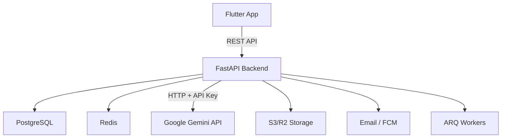
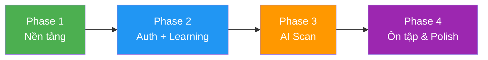

# 📋 Review Dự Án: App Học Tiếng Anh + AI

## 1. Tổng Quan

| Thông tin | Chi tiết |
|---|---|
| **Tên dự án** | App học tiếng Anh + AI |
| **Frontend** | Flutter (Dart 3.13.4) |
| **Backend** | FastAPI + PostgreSQL + Redis + **Gemini API** |
| **Trạng thái** | 🟡 **Giai đoạn triển khai** — Backend Phase 1 + Gemini integration hoàn thành, Flutter chưa bắt đầu |

## 2. Kiến Trúc Tổng Thể



### Đánh giá kiến trúc: ⭐⭐⭐⭐⭐ (5/5)
- **Ưu điểm**: Tách biệt rõ FE/BE, không để client gọi trực tiếp DB hay AI model
- **Ưu điểm**: Backend là nguồn chính cho mọi logic nghiệp vụ (XP, streak, quota, SRS)
- **Ưu điểm**: AI detection qua Gemini API — không cần GPU server, free tier đủ dùng
- **Ưu điểm**: Gemini trả thêm IPA, nghĩa Việt, ví dụ câu — phong phú hơn YOLO-World
- **Cần cải thiện**: Chưa có state management solution cho Flutter (Provider/Riverpod/Bloc?)

## 3. Cấu Trúc Frontend (Flutter)

### Tổ chức code: ⭐⭐⭐⭐⭐ (5/5)

```
lib/
├── app/              # MaterialApp, router, navigation shell
├── core/             # Network, storage, theme, widgets dùng chung
└── features/         # 7 features theo domain
    ├── auth/         # Đăng nhập/ký, guest, xác minh email
    ├── learning/     # Lộ trình, bài học, 5 dạng bài tập
    ├── scan/         # Camera AI, nhận diện vật thể
    ├── vocabulary/   # Kho từ vựng
    ├── review/       # Ôn tập SRS, flashcard
    ├── profile/      # Hồ sơ, cài đặt
    └── progress/     # XP, streak, mục tiêu
```

> [!TIP]
> Mô hình **feature-first** với phân tầng `data/domain/presentation` là best practice cho Flutter. Rất tốt!

### 18 giao diện đã lên kế hoạch

| Nhóm | Giao diện | Số lượng |
|---|---|---|
| Auth & Onboarding | Welcome, Survey, Login/Register | 3 |
| Learning | Bản đồ, Lesson shell, 5 dạng bài, Kết quả | 8 |
| AI Scan | Camera, Kết quả nhận diện | 2 |
| Vocabulary | Kho từ, Chi tiết từ | 2 |
| Review | Practice Hub, Flashcard | 2 |
| Profile | Hồ sơ/Thống kê/Cài đặt | 1 |
| **Tổng** | | **18** |

## 4. Cấu Trúc Backend (FastAPI)

### Tổ chức: ⭐⭐⭐⭐ (4/5)

```
backend/app/
├── core/             # Config, security, deps, errors
├── modules/          # 10 modules nghiệp vụ
│   ├── auth/         ├── users/        ├── content/
│   ├── learning/     ├── progress/     ├── scan/
│   ├── vocab/        ├── review/       ├── practice/
│   └── notifications/
├── integrations/     # Detector, storage, mailer, FCM
├── workers/          # ARQ background jobs
└── seed_data/        # Nội dung học tĩnh
```

### Quy tắc nghiệp vụ quan trọng
- ✅ PostgreSQL là source of truth
- ✅ Nội dung học được seed, không sinh tự động bằng LLM
- ✅ AI features yêu cầu email xác minh
- ✅ Quota, XP, streak do backend quản lý
- ✅ Ảnh scan dùng presigned URL, ảnh học dùng public CDN

## 5. Điểm Mạnh

| # | Điểm mạnh |
|---|---|
| 1 | **Tài liệu thiết kế rất chi tiết** — FileMap.md mô tả đầy đủ 253 dòng, rõ ràng từ kiến trúc đến từng file dự kiến |
| 2 | **Kiến trúc clean** — Tách FE/BE rõ ràng, feature-first, tầng data/domain/presentation |
| 3 | **Plugin research kỹ** — Chỉ ra đúng plugin cho từng tính năng, có chú thích khi nào cần và không cần |
| 4 | **Bảo mật tốt** — Token riêng, quyền AI server-side, không lưu binary vào DB |
| 5 | **Nhận diện mâu thuẫn** — Đã ghi nhận sự khác nhau FE/BE (XP +5 vs +10, ngưỡng speaking 75% vs 0.6) |

## 6. Điểm Cần Cải Thiện

> [!WARNING]
> ### Vấn đề quan trọng

| # | Vấn đề | Mức độ | Gợi ý |
|---|---|---|---|
| 1 | **Chưa có code Flutter** — Tất cả features chỉ là `.gitkeep`, main.dart là counter demo | 🔴 Cao | Đã chọn Riverpod — bắt đầu code core + auth Flutter |
| 2 | **Thiếu state management** — Chưa chọn Bloc/Riverpod/Provider | ✅ Đã giải quyết | **Chọn Riverpod 2.x** |
| 3 | **Thiếu dependency injection** — Chưa có `get_it` hay `injectable` | 🟡 TB | Riverpod thay thế DI, không cần get_it |
| 4 | **`main.dart` có lỗi cú pháp** — `colorScheme: .fromSeed(...)`, `mainAxisAlignment: .center` | ✅ Đã sửa | Ngày 6 |
| 5 | **Chưa có Docker Compose** — Backend cần PG, Redis container | ✅ Đã tạo | `docker-compose.yml` ở root |
| 6 | **Chưa có `pyproject.toml`** cho backend | ✅ Đã tạo | Poetry + đầy đủ dependencies |
| 7 | **Mâu thuẫn chưa giải quyết** — XP lưu từ, ngưỡng speaking, sửa nhãn | 🟢 Thấp | Chốt trước khi code features liên quan |

## 7. Lộ Trình Triển Khai Gợi Ý



### Phase 1 — Nền tảng ✅ Hoàn thành
- [x] Chọn state management → **Riverpod 2.x**
- [x] Backend: `docker-compose.yml`, `pyproject.toml`, `app/main.py`
- [x] Backend: Gemini API integration (`integrations/gemini/`)
- [x] Backend: Database models (User, Word, Scan, ScanItem) + Alembic
- [x] Backend: Auth module (register/login/refresh/verify-email)
- [x] Backend: Scan module (POST /scans với Gemini + Redis quota)
- [ ] Flutter: `core/theme`, `core/network`, `core/storage` ← **đang làm**
- [ ] Flutter: `app.dart` + `router.dart` + `main_shell.dart` ← **đang làm**

### Phase 2 — Auth + Learning
- [ ] UI: Welcome → Survey → Auth → Learning Path → Lesson
- [ ] Backend: Auth endpoints, learning/progress APIs
- [ ] 5 dạng bài tập + lesson shell

### Phase 3 — AI Scan + Vocabulary
- [ ] Camera + scan + kết quả nhận diện
- [ ] Kho từ vựng
- [ ] Backend: YOLO-World integration, vocab APIs

### Phase 4 — Review + Profile + Polish
- [ ] Flashcard SRS + Practice Hub
- [ ] Profile + Settings
- [ ] Push notifications, animations, performance

## 8. Kết Luận

| Tiêu chí | Đánh giá |
|---|---|
| Thiết kế & tài liệu | ⭐⭐⭐⭐⭐ Xuất sắc |
| Kiến trúc code | ⭐⭐⭐⭐ Rất tốt |
| Triển khai Backend | ⭐⭐⭐⭐ Phase 1 hoàn thành — Auth + Gemini + DB |
| Triển khai Flutter | ⭐ Chưa bắt đầu |
| Khả thi để hoàn thiện | ⭐⭐⭐⭐ Cao — đang theo đúng kế hoạch |

> [!IMPORTANT]
> Backend **Phase 1 đã hoàn thành**: Auth, Gemini scan, Redis quota, Docker Compose. Bước tiếp theo quan trọng nhất là **bắt đầu Flutter core** (theme, router, network layer) và chạy **Alembic migration** khi có Docker.
